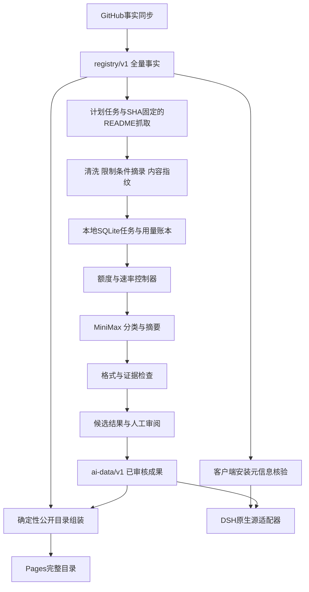

# Registry LLM 管线设计

设计日期：2026-11-09。状态：待实施。目标是为全量插件目录生成可追溯的中文摘要、用途分类和标签，并在日常同步时仅处理有效输入发生变化的项目。保留全量目录，客户端继续按 GitHub 星数默认排序。LLM 不决定插件能否安装，不生成安装命令或安装规格。

采用三个独立层：现有 GitHub 事实 Registry、独立持久化的 AI 成果、确定性组装的公开目录。模型失败不阻断事实同步；同步、重跑、发布都不能覆盖人工修订和既有 AI 成果。

## 当前仓库依据

检查基线提交 `223920375b3c4d66750b39a2bbf93ce06713271f`。

- `dsh-plugin-registry/registry/v1/index.json` 有28,996条，其中22,220条标记可安装；标记不等于真实安装验证。
- `src/sync.ts` 拉取事实并用规则分类；`src/filesystem.ts` 对整个 `registry/v1` 进行目录替换，不能把AI权威数据放在该目录中。
- `src/enrich.ts` 获取README后仅保存很短的介绍摘录。LLM 不能只消费这个摘录，必须另外保留固定SHA的正文和限制条件。
- `.github/workflows/registry-sync.yml` 每日同步，随后把 `registry/v1` 复制到Pages产物；发布流程目前不包含独立AI数据。
- `dsh-marketplace/src/client/MarketplaceTab.tsx` 已默认星数排序；`catalog.ts` 已有分类过滤。主要是接入摘要、分类来源和标签，不必重写排序。
- `docs/upstream-notes.md` 记录的是旧版上游，不能作为当前DSH Client原生源格式的依据。

## 容量与运行预算

用户后台实测：原100条处理约占5小时额度4%。该轮使用269,417 tokens、耗时196.758秒、并发3、30RPM，无429。不同长度、输出和提示版本会改变用量；4%是当前样本的近似值，不是服务端配额承诺。

| 项目 | 规划值 | 用途 |
| --- | --- | --- |
| 单条平均5小时额度 | 约0.04个百分点 | 初始估算，后续按实际用量校准 |
| 单窗口理论样本等价量 | 约2,500条 | 假设全部额度可用、样本分布相同 |
| 管线单窗口目标 | 最多80%，约2,000条样本等价请求 | 包含重试、修订和抽审模型调用，给其他使用留余量 |
| 新条目与修订分配 | 默认90%与10%，修订余量可归还 | 约1,800条新记录，加200次等价修订；不是固定请求数配额 |
| 提交与观察粒度 | 每100条一批，逐条落盘 | 每批核对用量、质量和下一批预算 |
| 速率初值 | 并发3、30RPM、180k估算TPM | 沿用跑通配置 |
| 可调整速率上界 | 并发6、60RPM、300k估算TPM | 配置上界，不是官方上限；只有额度充足、连续批次无429且实测吞吐受限时逐级提高 |

同分布简单外推：28,996条需要约1,160%的单窗口额度。按每窗口2,000条约15个窗口；若预留修订占满，则按1,800条新记录约17个窗口。若从新窗口开始、窗口之间5小时刷新、周额度足够且无人共享消耗，预计跨约3–3.5天完成首轮。实际会受周额度、窗口起点、样本长度及审阅耗时影响，不能承诺三天完成。仅按原速率连续请求约15.8小时，但这不包含等待额度恢复。

MiniMax官方当前说明：文本调用同时受5小时与周窗口约束，两个窗口独立刷新，且同账户工具共享额度；官方提供 `mmx quota` 查看用量。额度与速率是两套限制。来源：[用量说明](https://platform.minimax.cn/docs/m-plan/usage-rules)。

额度控制设计：

1. 优先做官方 `mmx quota` 适配器；实施时确认CLI安装状态、输出格式、国内站、当前账户与同一订阅Key的对应关系。不读取或复制其他工具的凭据，不假设有公开HTTP额度接口。
2. 启动读取5小时/周已用比例、重置时间、观测时间。管线窗口支出最多80个百分点，账户剩余也至少保留20%；以二者更紧的限制为准。周窗口同样保留20%。已授权的积分包不能被本管线主动当成提升额度的目标。
3. 周额度未知时，首轮只开放100条校准批次；得到用户后台快照或同账户官方查询后才排后续批次。提供 `quota record` 人工录入入口，记录来源和时间，不把人工读数伪装成实时数据。
4. 无实时额度源时，单次最多100条，使用最近观测值与悲观估算预留；每批后需要新快照才能继续较大批次。即使估算保留余量，也不能保证完全不碰已有积分包。
5. 有可靠自动查询时，每批前后及每5分钟查询一次；读取失败、剩余不足以覆盖最坏在途预算、达到周额度阈值时停止新请求。重置时间取服务端或官方CLI，不根据GitHub cron或程序启动时间猜。
6. 预算按实际prompt/completion用量、当前模型计量规则与后台百分比变化校准；初始使用100条=4%及输入/输出上限做保守预留。修订后62条提示更长，先完成这一批校准，不能直接照搬旧100条单位用量。
7. 主任务与修订共用同一账本，发出请求前预留、返回后结算；失败但可能计费的请求仍占预算。后台其他工具消耗直接反映为账户剩余减少。

## 数据流与目录



建议布局（均为未来新增，除明确注明已有者）：

```text
tools/ai-catalog/              # 已有本轮Python试验；扩展为正式管线
  cli.py                      # plan/run/resume/status/quota/review/export
  source.py                   # 固定SHA抓取、GitHub限速、正文缓存
  clean_readme.py              # 已有修订清洗，补真实样本回归
  schema_v2.py                 # 已有修订校验，迁移为明确版本的schema.py
  store.py                    # SQLite事务、租约、尝试和预算账本
  scheduler.py                # 额度/速率/优先队列与恢复
  provider_minimax.py          # 单一订阅端点、脱敏与错误分类
  validate.py                 # 格式、证据锚点、条件与复核规则
  review.py                   # 候选审批、人工override与导出
  tests/fixtures/             # 固定小样本、失败案例，无Key
.local/ai-catalog/             # 本机持久运行状态；gitignore
  state.sqlite3               # WAL与事务；程序退出不丢状态
  sources/<sha256>.txt         # 资料正文按内容寻址
  requests/<inputHash>.json    # 实际发给模型的公开资料，不含Key
  backups/                    # 一致性备份，不直接复制活跃WAL数据库
ai-data/v1/                   # Git跟踪的持久成果，不在registry/v1下面
  meta.json                   # 版本、覆盖数、内容revision
  records/<github-id>.json     # 最新被审核的结果及来源指纹
  overrides/<github-id>.json   # 人工修订、理由、针对的内容指纹
  reviews/                    # 可公开的审阅结论与回归清单
publish/                      # 临时组装目录，gitignore
  registry/v1/                # 保留全部ID的公开视图
  native/<adapter-version>/   # 仅核验通过的原生源
```

SQLite是本地调度状态，Git中的`ai-data`是已审核成果的可恢复副本。任务及候选结果每条事务提交，模型响应先落盘后进入导出。默认每批结束做一次SQLite backup API一致性备份、导出批次清单；不是仅在整个批次结束时才保存。磁盘写失败立刻停止调度。

## 任务身份与增量

身份用 `gh:<databaseId>`，仓库改名不产生新项目。

保存两个不同指纹：

- `sourceRevision`：抓取时的仓库head SHA、README实际路径及blob/content hash、仓库描述/主题等来源。
- `inputHash`：确定性序列化后的实际语义输入，加cleaner/prompt/schema/model/参数/分类体系版本。星数、抓取时间、head SHA本身不进入语义hash；否则任何代码提交都会浪费一次摘要调用。

head SHA变化先重取正文，清洗后的实际请求未变则复用结果，但更新来源绑定。仅星数或更新时间变化不跑LLM。README、描述、关键平台/依赖/安装上下文变化且改变实际输入才入队。仅原始代码示例变化而摘录不变时复用，但保留原文版本供审计。

`install_available`等会进入模型输入的上下文变化会改变hash；客户端兼容性提醒由程序按最新事实生成，不让模型自行起草。正式模型结构去掉兼容性自由文本，只保留摘要、分类、标签、证据和限制条件。

优先队列：62条修订集 → 新增且高星/标记可安装项目 → 其余高星项目 → 全量长尾 → 更新任务。批次中固定划20%给长尾/较老任务，防止新条目持续进入导致饥饿。所有有效目录条目均有任务；没有AI结果的仍出现在公开目录，用原介绍和规则分类回退。

版本升级不立即全量作废：先对固定回归集验证，再选择受影响类别或清洗差异项迁移。旧结果保留版本标签，不混称为新版本全量完成。

## 模型输出与质量门禁

一次请求只处理一个项目，分类、中文摘要和标签一起生成，减少跨项目串线和局部失败重付费。继续使用已测MiniMax-M3.1-Flash、low；变更模型与思考设置需要单独做回归。

候选结果保存：ID、40–100字左右摘要（硬上限140 Unicode字符）、现有10类之一、2–5个标签、1–3条证据、资料不足标志、自评confidence，以及结构化 `limitations`。每条证据要求返回输入段落ID与原文短引；程序校验段落存在、短引可定位。中文转述单独保留。证据锚点只能证明引用存在，不能证明摘要推理正确。

必须保留：设密码后启用认证、页面保持打开才能提醒、平台例外、外部组件前提、已实现/规划区别、估算不等于保证。图像识别不归媒体创作；量化研究按研究用途；模型适配器按开发用途。仓库原分类与星数不发给模型，避免锚定。

流程分为格式合格、风险复核、审核通过三个状态，不把格式通过当内容通过：

- 字段/长度/枚举/证据定位失败：可确定性修复的外层JSON包裹先修；不得截短摘要或默默删除证据来制造通过。最多一次模型修订，修订也计额度；再次失败隔离。
- 已审计错误条目、资料不足/被关键截断、条件冲突、类别边界、认证/安全/平台相关声明：进入人工复核队列。
- 首批62条逐条核对；后续先审阅新的100条，之后每100条随机抽查10条，并额外覆盖风险项、每类和长尾。抽样种子及审阅结论持久化。
- 抽查发现核心功能编造、遗漏安全启用条件等严重错误：冻结该批AI发布，扩大审阅同类；影响全局规则时暂停新调用、修规则后再校准。普通措辞问题进入修订，不抹掉已验证成果。
- 无高风险标记且抽样批次通过者标 `batch-approved`；人工逐条审阅标 `human-reviewed`，二者不混淆。confidence不作为放行阈值。

人工override优先于模型，且绑定inputHash。语义输入变化时override变为待复核，不被新模型输出悄悄替换。旧摘要若失配新内容，公开视图回退原介绍；可在详情提供标明来源日期的历史版本，不把过时AI内容当当前事实。

## 调度与故障恢复

任务状态：`pending → prepared → in_flight → candidate → needs_review/approved`；补充 `retry_wait`、`invalid`、`uncertain`、`blocked_quota`、`source_failed` 和 `removed`。

每个请求有attempt ID、inputHash、request hash、开始/结束时间、原始模型输出、token usage、停止原因、限流状态。密钥、鉴权头、思考内容不写入。

- 发送前事务写attempt并预留预算；单机进程锁防重复worker。领取任务有租约；完成写事务以attempt ID幂等合并。
- 崩溃后遗留 `in_flight` 变 `uncertain`，保留预算，不因为租约过期就自动重发。无服务商幂等保证时无法承诺请求恰好一次。核实结果不可恢复后，可显式 `retry-uncertain` 并记录可能重复计费。
- 明确429/已核实的速率拒绝：遵守Retry-After，至少60秒起指数退避加抖动，降低并发与速率。每任务最多2次限流重试；持续限流停止该窗口任务。
- 配额耗尽与速率拒绝分别识别。配额不足写nextEligibleAt后退出或等待；不会尝试切换按量Key、充值、升级或购买积分。
- 超时、连接中断、未知5xx、正文未完整读取：可能已经计费，标uncertain，不自动重发。401/403鉴权问题停止全部新调用。
- source抓取失败可以针对幂等GET重试，与模型请求重试规则隔离；GitHub限额和MiniMax限额各自维护。
- 同一个inputHash已有批准结果时不调用；候选尚未审阅也不重复调用。仓库删除只从当前公开视图排除，历史AI证据保留墓碑。

初期以Mac本地runner执行。Key由用户隐藏输入，进程内存持有；程序可在窗口间等待并继续，退出后恢复任务需重新输入Key。窗口等待是调度器行为，不占用聊天工具等待。Mac休眠或网络断开按上述恢复规则处理。

## 公开目录与原生源

事实目录仍为现有 `dsh-plugin-registry/registry/v1`。发布组装器复制事实到临时 `publish/registry/v1`，叠加批准且inputHash匹配的AI：

- `description` 使用中文摘要，否则原文介绍；`category` 使用批准的AI分类，否则既有规则分类。
- 新增可选 `ai` 字段，含summaryZh/tags/status/sourceInputHash/model/promptVersion/reviewLevel；详情保留原description、来源与限制条件。原文事实文件不被AI修改。
- 更新生产端和消费端Zod schema；生成JSON schemas。保持现有必需字段和schemaVersion=1，仅新增可选字段；若最终需要不兼容修改则另开v2。
- 发布revision必须由合并后公开index与details内容计算，不能沿用事实revision。AI变化但GitHub事实不变时客户端也必须刷新。
- 索引和详情须来自同一合并快照。客户端详情缓存当前仅核对ID，实施时加入revision或entry content hash绑定，避免摘要改了但详情还命中旧缓存。
- UI搜索覆盖中文摘要与AI标签；详情展示资料不足/未核验安装等必要状态。星数排序继续使用GitHub事实，LLM不参与排名。
- 发布前对全量ID集合、索引/详情引用、schema、可回退字段、内容revision做完整性验证；生成后原子发布同一Pages产物。AI失败或覆盖率不足不删除条目。

DSH Client原生源是独立适配器：实施时检查用户实际客户端版本、当前上游schema与入口URL。安装spec来自确定性核验，不允许LLM补全。区分 `metadata-verified` 与 `install-tested`；除非确实测试，不能标安装成功。默认仅导出格式、包身份、目标版本/提交、bundle入口及当前适配器要求均核验通过的条目；需要未批准构建脚本或元信息冲突的先排除。全量目录仍保留这些条目及排除理由统计。

## GitHub Actions 与持久化边界

第一阶段模型只在Mac跑，Actions执行离线测试、AI成果验证、增量计划和Pages发布。现有“不擅自保存Key”约束继续生效，不把Key写进仓库、Keychain或GitHub Secrets。

发布采用一个共享concurrency组，事实同步与AI发布不能分别覆盖Pages。抽取可复用 `registry-publish.yml`：统一从最新提交构建事实与批准AI快照；同步和AI成果合入后均调用它。发布阶段不在调用LLM时长内持锁。提交竞争要先fetch并对比revision，不能强推覆盖另一条流水线。

AI已审核数据通过可审阅PR合入 `ai-data/v1`，PR触发离线验证；推主分支触发唯一发布器。模型worker不自动发布。SQLite与大体积原始README不放主分支；本地持久状态与一致性备份用于续跑，Git审核成果用于灾后重建“已完成”任务。Actions artifact可作临时报告，不能当唯一持久状态。

后续若用户明确授权托管凭据，再启用独立 `ai-enrich.yml` 工作流：只针对可信主分支、禁止外部PR拿Secret；每次运行时间有上限、每批导出状态、由同一AI状态分支或外部持久存储串行接管任务。不得仅恢复一个可能过期的cache就声称断点可靠。此托管扩展不阻碍本地首轮全量。

## 仓库改动清单

下面“已有”指上一轮实际本地修改；“拟修改/新增”指本次设计建议，尚未实现。

| 路径 | 状态 | 具体改动 |
| --- | --- | --- |
| `docs/llm-pipeline-design.md` | 本次新增 | 本设计与实施范围 |
| `tools/ai-catalog/clean_readme.py` | 已有修改基础 | HTML解析修复；后续补段落ID、稳定摘录、真实样本回归 |
| `tools/ai-catalog/schema_v2.py` | 已有新增 | 更严格校验及提示；正式版本迁移，加入证据锚点和limitations |
| `tools/ai-catalog/minimax_validate.py`、`run_revision.py`、`prepare_revision.py` | 已有新增 | 保留62条修订入口作回归，正式生产不沿用单次锁脚本冒充续跑管线 |
| `tools/ai-catalog/{cli,source,store,scheduler,provider_minimax,validate,review}.py` | 拟新增 | 正式抓取、增量、SQLite、额度、运行、审阅与导出 |
| `tools/ai-catalog/tests/` | 拟新增 | 调度恢复、预算、故障注入及固定样本 |
| `ai-data/v1/` | 拟新增 | Git持久化批准结果、人工override、审核与版本 |
| `.gitignore` | 拟修改 | 忽略`.local/ai-catalog`、`publish`及SQLite临时文件，保留公开成果 |
| `dsh-plugin-registry/src/ai.ts` | 拟新增 | 加载并验证AI成果、匹配inputHash、生成回退/叠加视图 |
| `dsh-plugin-registry/src/publish.ts`、`publish-cli.ts` | 拟新增 | 组装完整发布快照，重新计算revision和校验完整性 |
| `dsh-plugin-registry/src/schema.ts` | 拟修改 | AI公开可选字段和证据/审核状态schema |
| `dsh-plugin-registry/src/protocol.ts` | 拟修改 | 允许对合并视图统一构建文档与revision，保留原事实构建能力 |
| `dsh-plugin-registry/src/types.ts` | 拟修改 | 导出AI与公开视图类型 |
| `dsh-plugin-registry/src/sync.ts` | 拟修改 | 输出含变更类型的机器可读manifest给增量计划；事实同步不调用模型 |
| `dsh-plugin-registry/src/enrich.ts`、`github.ts` | 首版不改 | Python抓取器按事实SHA独立缓存正文；避免在两套抓取接口间反复搬动逻辑 |
| `dsh-plugin-registry/src/install.ts` | 第一阶段不改 | 保留现有推断；原生适配新增独立严格核验，不能把现有available改称实测 |
| `dsh-plugin-registry/src/native/` | 拟新增，后置 | 当前DSH Client schema适配、安装元信息校验、排除报告 |
| `dsh-plugin-registry/schemas/*.schema.json` | 拟重新生成 | 与新增可选AI字段同步 |
| `dsh-marketplace/src/shared/schema.ts` | 拟修改 | 消费端显式解析AI字段 |
| `dsh-marketplace/src/registry/service.ts` | 拟修改 | 公开AI视图、缓存revision绑定和完整性验证 |
| `dsh-marketplace/src/client/catalog.ts` | 拟修改 | 中文摘要与标签搜索；保持星数排序 |
| `dsh-marketplace/src/client/PluginDetails.tsx`、`MarketplaceTab.tsx`、`locales.ts` | 拟修改 | 展示AI摘要/必要条件、原介绍与来源状态，保持现有筛选布局 |
| `dsh-plugin-registry/package.json`、根`package.json` | 拟修改 | plan/status/review/export/publish/native命令入口 |
| `.github/workflows/ci.yml` | 已有修改并拟扩展 | 已加5项离线Python回归；正式增加AI数据/发布一致性测试 |
| `.github/workflows/registry-sync.yml` | 拟修改 | 同步事实后调用统一发布工作流，不再单独复制并部署裸事实目录 |
| `.github/workflows/registry-publish.yml` | 拟新增 | 统一Pages组装、校验、原子部署与concurrency |
| `.github/workflows/ai-enrich.yml` | 后置且默认禁用 | 用户另行授权托管凭据后才启用模型任务 |
| `README.md`、`docs/spec-compliance.md` | 拟修改 | 数据来源、摘要覆盖、增量续跑及原生源边界说明 |

当前本地已有变更包括 `.github/workflows/ci.yml` 和未提交的 `tools/ai-catalog/`。本次仅新增此设计文档，不修改这些既有实现、不执行模型调用、不提交推送或发布。

## 实施顺序和验收

1. 修订质量校准：跑准备好的62条，逐条核对；记录新提示实际5小时及周用量。真实失败样本进入固定回归。
2. 完成生产任务与持久化：SQLite、增量hash、额度适配、恢复和逐条落盘。用模拟响应验证崩溃在发送前/发送后/落盘后、重复恢复、429、额度读取失败、个人共享消耗及磁盘失败。
3. 跑新100条并审阅，然后每窗口分批回填全量。状态报告包含总量/待处理/候选/批准/复核/失败/不确定、实际tokens、两窗口额度、重置时间、预计剩余窗口；不得只报请求成功率。
4. 接入合并视图和客户端，验证AI失败保留全量、仅星数变化零模型调用、输入不变复用、人工覆盖不丢、AI更新触发revision变化及详情缓存失效。先形成可审阅差异与PR，再发布。
5. 检查当前DSH Client原生源协议，完成严格元信息核验和独立源导出测试后接入发布。不把全量目录直接改名为原生安装源。

核心验收：未改变有效输入的仓库不重复花额度；任何已返回响应与人工结论可恢复；无模型结果也不丢目录条目；人工覆盖不被同步覆盖；公开安装信息全部来自确定性事实；5小时与周额度同时受控；发布只包含可解释来源、可回滚的同一快照。
